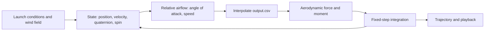

# Disc Flight Simulator

**A MATLAB flight simulator for a disc golf disc, developed from a pseudo 6-DOF trajectory model into a full 6-DOF rigid-body model with quaternion attitude, an OpenFOAM-derived aerodynamic database, and an interactive 3D playback.**


<p align="center">
  
</p>

Carter Tucker - Summer 2026

Launch Conditions (for the figures above)
- Speed: 29 m/s
- Roll Angle: 0 deg
- Pitch Angle: 4 deg
- Yaw Angle 0 deg
- Release Height: 1.7 m
- Spin Rate: 550 RPM

---

## Overview

Disc flight is a coupled problem. Lift, drag and pitching moment depend on the disc's angle of attack, and a pitching moment acting on a rapidly spinning body produces gyroscopic roll rather than pitch. A point-mass model cannot capture this, and a model that tracks roll only through precession cannot capture wobble or off-axis effects.

This project builds the model up in stages:

1. **Pseudo 6-DOF.** A re-implementation of the trajectory model in the reference paper (see [Reference](#reference)): translation is integrated fully, and attitude evolves only through gyroscopic precession at a constant spin rate.
2. **True 6-DOF, Euler angles.** Translation and rotation are both integrated from the full rigid-body equations of motion.
3. **True 6-DOF, quaternion attitude.** The same model with attitude carried as a quaternion, which avoids Euler-angle singularities and gimbal lock.

Aerodynamic forces and moments come from a lookup table ([`output.csv`](output.csv)) generated by an OpenFOAM pipeline and indexed by angle of attack, spin rate, and flow velocity. The pipeline which runs simulations to create the aerodynamic lookup table from a 3D model of a disc is in a separate repo [Disc-Aero-Pipeline](https://github.com/CarterTucker/Disc-Aero-Pipeline). The current simulator also plays the flight back in 3D, with the disc's orientation shown next to its trajectory.

The entire pipeline which consists of the [Disc-Aero-Pipeline](https://github.com/CarterTucker/Disc-Aero-Pipeline) and the simulator here allows you to take a 3D model of any disc, obtain the flight characteristics from an automated CFD script, and predict the flight for a throw of a set speed, spin rate, roll angle, pitch angle, and yaw angle. The only required user input unrelated to the throw is the disc mass, as it varies in production.

## Simulator

The current version ([`disc_flight_simulator_6dof_quaternion_fixedint_v1.m`](Flight%20Simulator%20%286-DOF%29/quaternion/disc_flight_simulator_6dof_quaternion_fixedint_v1.m)) shows the disc's attitude beside the flight path, with a play button to step through the throw.

Configurable inputs include:

- Disc mass
- Disc moments of inertia
- Wind vector field
- Launch conditions (release speed, angles, spin rate)

<p align="center">
  
</p>

<p align="center"><em>Top and side views of a simulated throw.</em></p>

Launch Conditions:
- Speed: 29 m/s
- Roll Angle: -5 deg
- Pitch Angle: 3 deg
- Yaw Angle 0 deg
- Release Height: 1.0 m
- Spin Rate: 1500 RPM

## Validation

The model is checked against the flight patterns published on [Infinite Discs](https://infinitediscs.com), which aggregates trajectories reported by many users and by manufacturers. For the disc used in the figures above, the simulated flight reproduces the expected shape of the reference pattern.

<p align="center">
  
</p>

<p align="center"><em>Reference flight pattern for the simulated disc, from Infinite Discs.</em></p>

The simulated disc was a Discraft Zone SS, though any disc can be simulated by running the aero pipeline and inserting the STL.

## Model Progression

| Version | Attitude | Rotational dynamics | Location |
|---|---|---|---|
| Pseudo 6-DOF | Roll only, from gyroscopic precession | Constant spin rate assumed | `Flight Simulator (pseudo 6-DOF)/` |
| 6-DOF | Euler angles | Full | `Flight Simulator (6-DOF)/standard/` |
| 6-DOF | Quaternion | Full | `Flight Simulator (6-DOF)/quaternion/` |
| **6-DOF, quaternion, fixed-step, full simulator (current)** | Quaternion | Full | [`..._quaternion_fixedint_v1.m`](Flight%20Simulator%20%286-DOF%29/quaternion/disc_flight_simulator_6dof_quaternion_fixedint_v1.m) |

Files with `fixedint` in the name step through the ODEs directly instead of calling MATLAB's `ode45`.

## Method

### Governing equations

Translation and rotation of a rigid body:

$$m\,\dot{\mathbf{v}} = \mathbf{F}_{aero} + m\mathbf{g}$$

$$\mathbf{I}\,\dot{\boldsymbol{\omega}} + \boldsymbol{\omega} \times (\mathbf{I}\,\boldsymbol{\omega}) = \mathbf{M}_{aero}$$

Quaternion attitude kinematics:

$$\dot{\mathbf{q}} = \tfrac{1}{2}\,\mathbf{q} \otimes \begin{bmatrix} 0 \\ \boldsymbol{\omega} \end{bmatrix}$$

Aerodynamic loads use the standard coefficient definitions, with $q = \tfrac{1}{2}\rho U^2$, planform area $S$, and disc diameter $D$:

$$F_L = q\,C_L\,S, \qquad F_D = q\,C_D\,S, \qquad M = q\,C_M\,D\,S$$

### Aerodynamic lookup table

[`output.csv`](output.csv) is the output of a disc aerodynamics pipeline built on **OpenFOAM**, with a Python script that automates the CFD runs. It maps **angle of attack, spin rate, and flow velocity** to the **lift and moment** parameters used by the simulator, which interpolates it at each time step.

The pipeline lives in a separate repository: [Disc-Aero-Pipeline](https://github.com/CarterTucker/Disc-Aero-Pipeline)

| Column | Meaning | Units |
|---|---|---|
| aoa_deg | Angle of attack | deg |
| beta_deg | Sideslip angle | deg |
| velocity | Flow velocity | m/s |
| CL | Lift parameter | [ ] |
| CD | Drag parameter | [ ] |
| Cm | Pitching moment parameter | [ ] |
| Cl_roll | Rolling moment parameter | [ ] |
| Cn_yaw | Yawing moment parameter | [ ] |

### Simulation loop



## Repository Structure

```
Disc-Flight-Simulator/
├── output.csv                                Aerodynamic lookup table (OpenFOAM)
├── Flight Simulator (6-DOF)/
│   ├── quaternion/                           Quaternion attitude, includes current _v1 full simulator
│   └── standard/                             Euler-angle attitude
├── Flight Simulator (pseudo 6-DOF)/
│   └── disc_flight_simulator_pseudo6dof.m    Pseudo 6-DOF model
├── images/                                   Figures used in this README
└── reference-media/
    └── s12283-022-00390-5.pdf                Reference paper
```

## Running the Simulation

1. Clone the repo and open MATLAB in the repo root, so `output.csv` is on the path.
2. Run `Flight Simulator (6-DOF)/quaternion/disc_flight_simulator_6dof_quaternion_fixedint_v1.m`.
3. Edit the mass, inertia, wind vector field and launch conditions at the top of the script, then press the play button in the figure window to step through the throw.

## Limitations

- **Validation is comparative.** The reference flight patterns aggregate user and manufacturer reports. They are not instrumented throw data, so agreement is about flight shape, not tracked-throw accuracy.
- **Aero Table Range**
| Column | Range | Units |
|---|---|---|
| aoa_deg | -10 - 25 | deg |
| beta_deg | -15 - 15 | deg |
| velocity | 8 - 14 | m/s |

Resolution was higher for angles of attack which disc flight is commonly characteristic of.

## Reference

The pseudo 6-DOF model follows the approach in:

K. E. T. Giljarhus, M. T. Gooding, and J. Njærheim, "Disc golf trajectory modelling combining computational fluid dynamics and rigid body dynamics," *Sports Engineering*, vol. 25, art. 26, 2022. [doi:10.1007/s12283-022-00390-5](https://doi.org/10.1007/s12283-022-00390-5)

The paper is open access under [CC BY 4.0](https://creativecommons.org/licenses/by/4.0/), and a copy is included in [`reference-media/`](reference-media/s12283-022-00390-5.pdf). The authors' own open-source Python implementation is [Shotshaper](https://github.com/kegiljarhus/shotshaper).

## Why I Built This

I began playing disc golf the beginning of the Summer in 2026 with my brother and some friends. When I left to go back to MIT, disc golf naturally became a project, rather than just a hobby. Disc manufacturers rate discs with four flight numbers, which are speed, turn, fade, and glide. Speed describes how fast the disc should be thrown to exhibit the other characteristics, turn describes the drift in the first half of the flight, fade describes the drift in the second half of the flight, and glide describes how fast the disc loses altitude. For how specific the numbers are, they are subjective and differ between manufacturers, so I figured there must be a solution.

I decided to practice my CFD and MATLAB skills in attempting to make a simulator which accurately predicts the flight of any disc, for any throw, in any wind conditions, and that was when the flight simulator was born. Over a couple weeks in the summer, in was my ONLY project. I ran automated OpenFOAM simulations for hours overnight, switched frequently between Euler and quanternion attitudes, and actually played disc golf to take breaks while the sim was running. Finally the project is complete, according to my initial goals, though I may come back to mess with the user experience in the future.

## What I Learned

As far as the simulator goes, I used a lot of what I learned in MIT's 2.003, Dynamics and Controls I, but I had to do a lot of research on quanternion-based state expressions to account for any possible singularities in flight. I began with a pseudo-6DOF model which was outlined in the reference research paper linked in the reference media folder. From there, it was feasible to extend to a true 6-DOF model, which the paper hadn't covered. Most of what I learned was actually in aerodynamics and aerodynamics simulation, which I cover in the [Disc-Aero-Pipeline](https://github.com/CarterTucker/Disc-Aero-Pipeline) repo.

## Contact

Carter Tucker: [LinkedIn](https://www.linkedin.com/in/carter-tucker-36083b32a/))
