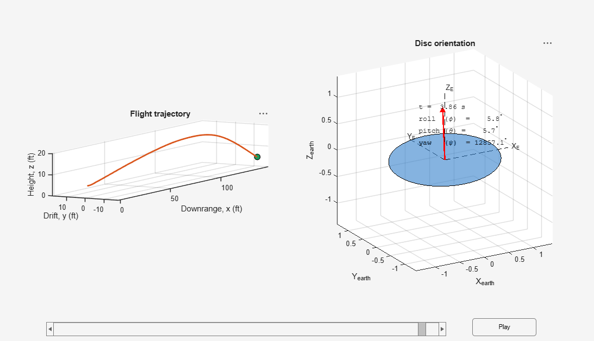
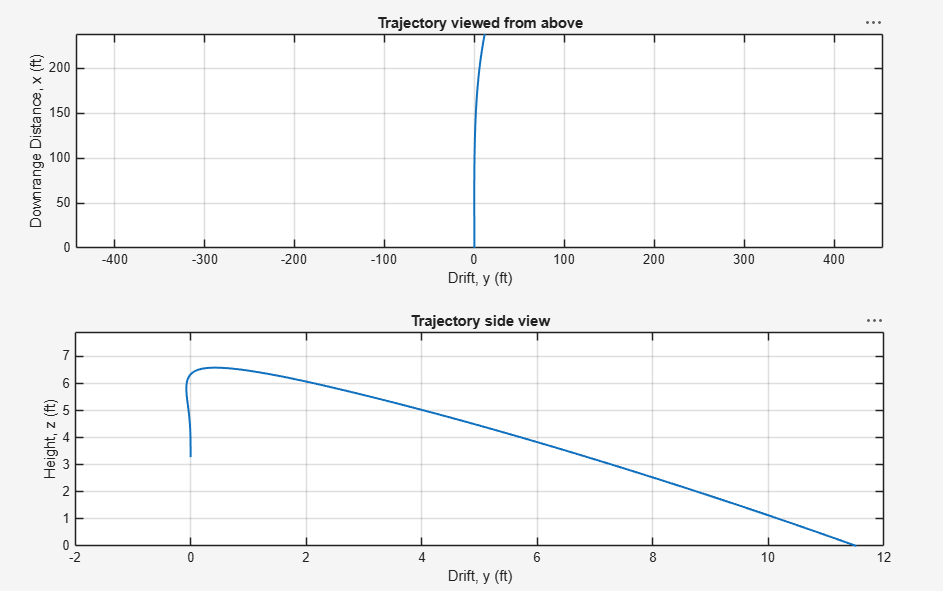
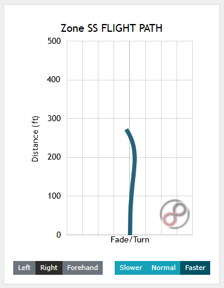
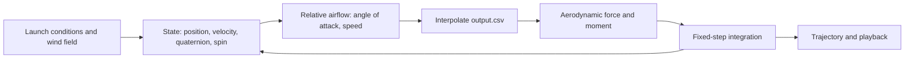

# Disc Flight Simulator

**A MATLAB flight simulator for a disc golf disc, developed from a pseudo 6-DOF trajectory model into a full 6-DOF rigid-body model with quaternion attitude, an OpenFOAM-derived aerodynamic database, and an interactive 3D playback.**


<p align="center">
  
</p>

Carter Tucker
> **TODO:** Link the course or project context if there is one (class, year, or personal project).

---

## Overview

Disc flight is a coupled problem. Lift, drag and pitching moment depend on the disc's angle of attack, and a pitching moment acting on a rapidly spinning body produces gyroscopic roll rather than pitch. A point-mass model cannot capture this, and a model that tracks roll only through precession cannot capture wobble or off-axis effects.

This project builds the model up in stages:

1. **Pseudo 6-DOF.** A re-implementation of the trajectory model in the reference paper (see [Reference](#reference)): translation is integrated fully, and attitude evolves only through gyroscopic precession at a constant spin rate.
2. **True 6-DOF, Euler angles.** Translation and rotation are both integrated from the full rigid-body equations of motion.
3. **True 6-DOF, quaternion attitude.** The same model with attitude carried as a quaternion, which avoids Euler-angle singularities and gimbal lock.

Aerodynamic forces and moments come from a lookup table ([`output.csv`](output.csv)) generated by an OpenFOAM pipeline and indexed by angle of attack, spin rate, and flow velocity. The current simulator also plays the flight back in 3D, with the disc's orientation shown next to its trajectory.

> **TODO:** One or two sentences on the goal: what were you trying to predict or understand (for example, how launch parameters change flight shape)?

## Simulator

The current version ([`disc_flight_simulator_6dof_quaternion_fixedint_v1.m`](Flight%20Simulator%20%286-DOF%29/quaternion/disc_flight_simulator_6dof_quaternion_fixedint_v1.m)) shows the disc's attitude beside the flight path, with a play button to step through the throw.

Configurable inputs include:

- Disc mass
- Disc moments of inertia
- Wind vector field
- **TODO:** Launch conditions (release speed, angles, spin rate) and any other parameters exposed at the top of the script

<p align="center">
  
</p>

<p align="center"><em>Top and side views of a simulated throw.</em></p>

> **TODO:** Add the launch conditions used for this figure (release speed, angles, spin rate, wind) so a reader can reproduce it.

## Validation

The model is checked against the flight patterns published on [Infinite Discs](https://infinitediscs.com), which aggregates trajectories reported by many users and by manufacturers. For the disc used in the figures above, the simulated flight reproduces the expected shape of the reference pattern.

<p align="center">
  
</p>

<p align="center"><em>Reference flight pattern for the simulated disc, from Infinite Discs.</em></p>

> **TODO:** Name the disc, and say which launch conditions you matched to the reference. If you can, overlay your simulated path on the reference image, or list a couple of numbers (distance, peak height, and the amount and direction of turn and fade). This turns the check from visual to quantitative.

## Model Progression

| Version | Attitude | Rotational dynamics | Location |
|---|---|---|---|
| Pseudo 6-DOF | Roll only, from gyroscopic precession | Constant spin rate assumed | `Flight Simulator (pseudo 6-DOF)/` |
| 6-DOF | Euler angles | Full | `Flight Simulator (6-DOF)/standard/` |
| 6-DOF | Quaternion | Full | `Flight Simulator (6-DOF)/quaternion/` |
| **6-DOF, quaternion, fixed-step, full simulator (current)** | Quaternion | Full | [`..._quaternion_fixedint_v1.m`](Flight%20Simulator%20%286-DOF%29/quaternion/disc_flight_simulator_6dof_quaternion_fixedint_v1.m) |

Files with `fixedint` in the name step through the ODEs directly instead of calling MATLAB's `ode45`.

> **TODO:** Say why you moved from `ode45` to fixed-step (for example, control over the time step, coupling with the playback, or per-step lookups from the aero table), and give the step size and scheme (forward Euler, RK4, etc.).

## Method

### Governing equations

Translation and rotation of a rigid body:

$$m\,\dot{\mathbf{v}} = \mathbf{F}_{aero} + m\mathbf{g}$$

$$\mathbf{I}\,\dot{\boldsymbol{\omega}} + \boldsymbol{\omega} \times (\mathbf{I}\,\boldsymbol{\omega}) = \mathbf{M}_{aero}$$

Quaternion attitude kinematics:

$$\dot{\mathbf{q}} = \tfrac{1}{2}\,\mathbf{q} \otimes \begin{bmatrix} 0 \\ \boldsymbol{\omega} \end{bmatrix}$$

Aerodynamic loads use the standard coefficient definitions, with $q = \tfrac{1}{2}\rho U^2$, planform area $S$, and disc diameter $D$:

$$F_L = q\,C_L\,S, \qquad F_D = q\,C_D\,S, \qquad M = q\,C_M\,D\,S$$

### Aerodynamic lookup table

[`output.csv`](output.csv) is the output of a disc aerodynamics pipeline built on **OpenFOAM**, with a Python script that automates the CFD runs. It maps **angle of attack, spin rate, and flow velocity** to the **lift and moment** parameters used by the simulator, which interpolates it at each time step.

The pipeline lives in a separate repository: **TODO:** link it here.

| Column | Meaning | Units |
|---|---|---|
| **TODO** | Angle of attack | deg or rad |
| **TODO** | Spin rate | rad/s or rpm |
| **TODO** | Flow velocity | m/s |
| **TODO** | Lift parameter | **TODO** |
| **TODO** | Moment parameter | **TODO** |

> **TODO:** Say which disc geometry the table represents, the ranges of angle of attack, spin and velocity it covers, and the CFD setup in one line (turbulence model, mesh size).

### Simulation loop



## Repository Structure

```
Disc-Flight-Simulator/
├── disc_flight_simulator_6dof_fixedint.m     TODO: describe, or move into standard/
├── output.csv                                Aerodynamic lookup table (OpenFOAM)
├── Flight Simulator (6-DOF)/
│   ├── quaternion/                           Quaternion attitude, includes current _v1 full simulator
│   └── standard/                             Euler-angle attitude
├── Flight Simulator (pseudo 6-DOF)/
│   └── disc_flight_simulator_pseudo6dof.m    Pseudo 6-DOF model
├── images/                                   Figures used in this README
└── reference-media/
    └── s12283-022-00390-5.pdf                Reference paper
```

## Running the Simulation

**Requirements:** MATLAB (**TODO:** version and any toolboxes).

1. Clone the repo and open MATLAB in the repo root, so `output.csv` is on the path.
2. Run `Flight Simulator (6-DOF)/quaternion/disc_flight_simulator_6dof_quaternion_fixedint_v1.m`.
3. Edit the mass, inertia, wind vector field and launch conditions at the top of the script, then press the play button in the figure window to step through the throw.

## Limitations

- **Validation is comparative.** The reference flight patterns aggregate user and manufacturer reports. They are not instrumented throw data, so agreement is about flight shape, not tracked-throw accuracy.
- **TODO:** Range of the aero table, and how the model behaves outside the tabulated angle of attack, spin and velocity.
- **TODO:** Effects not modeled (ground contact, disc wear, throw biomechanics, and so on).

## Reference

The pseudo 6-DOF model follows the approach in:

K. E. T. Giljarhus, M. T. Gooding, and J. Njærheim, "Disc golf trajectory modelling combining computational fluid dynamics and rigid body dynamics," *Sports Engineering*, vol. 25, art. 26, 2022. [doi:10.1007/s12283-022-00390-5](https://doi.org/10.1007/s12283-022-00390-5)

The paper is open access under [CC BY 4.0](https://creativecommons.org/licenses/by/4.0/), and a copy is included in [`reference-media/`](reference-media/s12283-022-00390-5.pdf). The authors' own open-source Python implementation is [Shotshaper](https://github.com/kegiljarhus/shotshaper).

## Why I Built This

> **TODO:** A short paragraph in your own voice: what drew you to disc flight, and why you went beyond the paper's model.

## What I Learned

> **TODO:** Two or three sentences. What surprised you, and what you would extend next (for example, a throw-parameter optimizer or more detailed wind modeling).

## License

> **TODO:** Choose a license (for example MIT) and add a `LICENSE` file. The reference paper keeps its own CC BY 4.0 license.

## Contact

Carter Tucker: [LinkedIn](https://www.linkedin.com/in/TODO) | **TODO:** email or personal site
